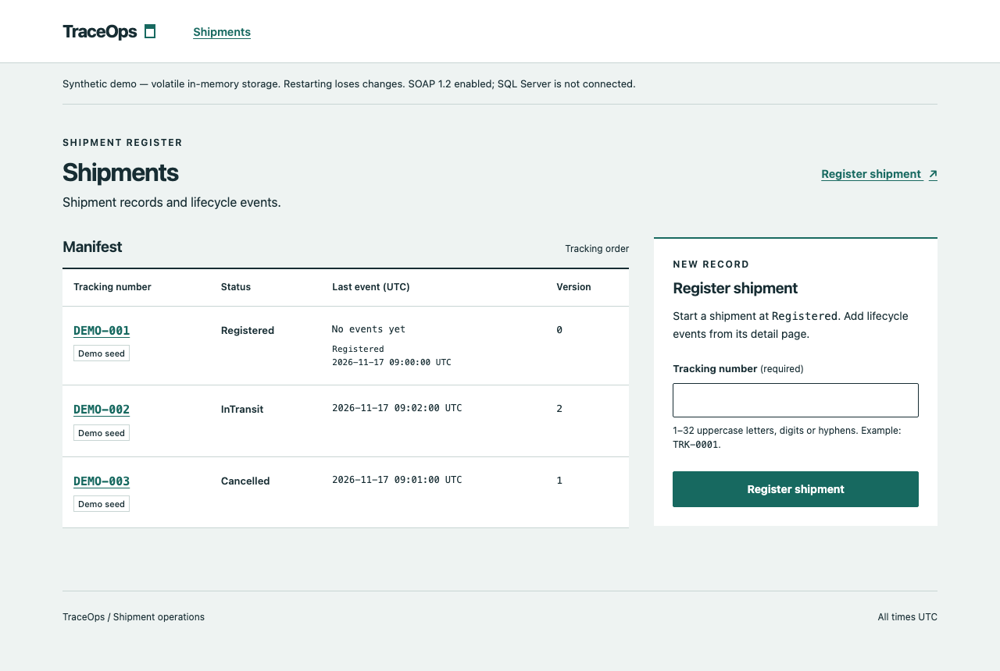

# TraceOps

[](https://github.com/zexy2/traceops/actions/workflows/ci.yml)

A shipment tracking (track-and-trace) service in C# / ASP.NET Core. One lifecycle model is exposed through a server-rendered MVC UI, a REST/JSON API and a SOAP 1.2/XML endpoint. Data can live in memory or in SQL Server, behind T-SQL stored procedures.

All data is synthetic. This is a portfolio project, not a production system.



## What it does

- **Shipment lifecycle:** shipments move through `Registered → Accepted → InTransit → OutForDelivery → Delivered`, with `Cancelled` and `DeliveryFailed` branches. The domain model rejects any other transition.
- **Idempotent events:** each lifecycle event has a client-supplied UUID.
  - Re-sending the same event returns `200` with `duplicate: true` and records nothing new.
  - Reusing an event ID with a different payload is rejected as `EVENT_ID_CONFLICT`.
  - Events with a timestamp older than the shipment's last event are rejected.
- **Three interfaces, one behaviour:** the MVC pages, the REST API and the SOAP service all call the same application service, so they enforce the same rules and return the same error codes.
- **SQL Server storage:**
  - Four stored procedures handle all access: `Shipment_List`, `Shipment_Find`, `Shipment_TryRegister` and `Shipment_AppendEvent`.
  - Writes run in `SERIALIZABLE` transactions with `UPDLOCK, HOLDLOCK`.
  - Unique constraints stop two concurrent requests from recording the same event twice.
  - The app connects as a dedicated login that can only `EXECUTE` procedures in its own schema; it cannot `SELECT`, modify tables or run DDL.
- **Integrity check on read:** when a shipment is loaded from SQL Server, its event history is replayed through the domain model. If the stored status disagrees with that history, the shipment is not returned.
- **Supportability:**
  - Every response carries an `X-Correlation-ID`.
  - Errors use one `application/problem+json` shape with a stable `code`, and never leak stack traces, SQL or connection details.
  - The app refuses to start in SQL mode unless the database name, server name and all four procedures check out.
- **XML safety:** the SOAP endpoint prohibits DTDs, uses no external entity resolver (XXE protection) and limits request size. Faults map to the same error codes as REST.

## Architecture

```
src/
  TraceOps.Domain        Pure lifecycle model: states, transitions, idempotency rules
  TraceOps.Application   ShipmentService and storage contract (IShipmentStore)
  TraceOps.SqlServer     SQL Server store + migration with the stored procedures
  TraceOps.Web           ASP.NET Core MVC pages, REST controllers, SOAP service (SoapCore)
tests/
  TraceOps.Domain.Tests      124 tests  lifecycle rules
  TraceOps.Web.Tests         212 tests  MVC, REST, problem details, correlation IDs
  TraceOps.Soap.Tests        189 tests  WSDL, envelopes, faults, XML security
  TraceOps.SqlServer.Tests   133 tests  procedures, transactions, concurrency, permissions (real SQL Server)
  TraceOps.SqlHost.Tests      21 tests  the web app started against SQL Server, REST and SOAP end to end
```

The domain layer has no dependencies. Storage is swappable behind `IShipmentStore`: an in-memory store for the demo and a SQL Server store for the integration suites. The SQL tests run against a real SQL Server 2022 instance, not a mock or SQLite.

## Run it

Requires the .NET 10 SDK (version pinned in `global.json`).

### In-memory demo

```sh
dotnet run --project src/TraceOps.Web
```

Open http://127.0.0.1:5080. Three demo shipments are seeded; changes are lost on restart. To enable the SOAP endpoint:

```sh
TraceOps__Soap__Enabled=true dotnet run --project src/TraceOps.Web
```

The WSDL is then at http://127.0.0.1:5080/soap/shipments?wsdl.

### With SQL Server (Docker)

```sh
cp .env.example .env        # then set both passwords
./scripts/db-setup.sh       # starts SQL Server 2022, creates the database, login and schema
./scripts/run-sql.sh        # runs the app on http://127.0.0.1:5080 with SQL storage
```

## REST API

| Method | Path | Result |
|---|---|---|
| `POST` | `/api/v1/shipments` | `201` new shipment; `409 TRACKING_NUMBER_CONFLICT` if it exists |
| `GET` | `/api/v1/shipments/{trackingNumber}` | `200` current state; `404 SHIPMENT_NOT_FOUND` |
| `POST` | `/api/v1/shipments/{trackingNumber}/events` | `201` new event; `200` exact duplicate; `409` conflict or invalid transition |

```sh
curl -X POST http://127.0.0.1:5080/api/v1/shipments \
  -H 'Content-Type: application/json' -d '{"trackingNumber":"TRK-0001"}'

curl -X POST http://127.0.0.1:5080/api/v1/shipments/TRK-0001/events \
  -H 'Content-Type: application/json' \
  -d '{"eventId":"2f1c8a52-6d0e-4b8e-9b5a-0c2d6b1e7f10","status":"Accepted","occurredAt":"2030-01-01T09:00:00Z","sourceSystem":"warehouse"}'
```

Error response:

```json
{
  "type": "about:blank",
  "title": "Conflict",
  "status": 409,
  "code": "INVALID_TRANSITION",
  "detail": "The requested shipment status transition is not allowed.",
  "instance": "/api/v1/shipments/TRK-0001/events",
  "correlationId": "..."
}
```

## SOAP

SOAP 1.2 with a WSDL. Operations: `RegisterShipment`, `GetShipment`, `AddShipmentEvent`.

## Tests

```sh
dotnet test tests/TraceOps.Domain.Tests
dotnet test tests/TraceOps.Web.Tests
dotnet test tests/TraceOps.Soap.Tests
./scripts/test-sql.sh       # SQL Server suites, after ./scripts/db-setup.sh
```

CI runs all five suites on every push. The SQL suites run against a SQL Server 2022 service container, and the app is smoke-tested in SQL mode through the REST API.

## Limits

- Synthetic data only. No real carriers, customers or locations.
- No authentication. The app listens on `127.0.0.1` only and is not meant to be exposed.
- Single tenant.

## License

MIT
